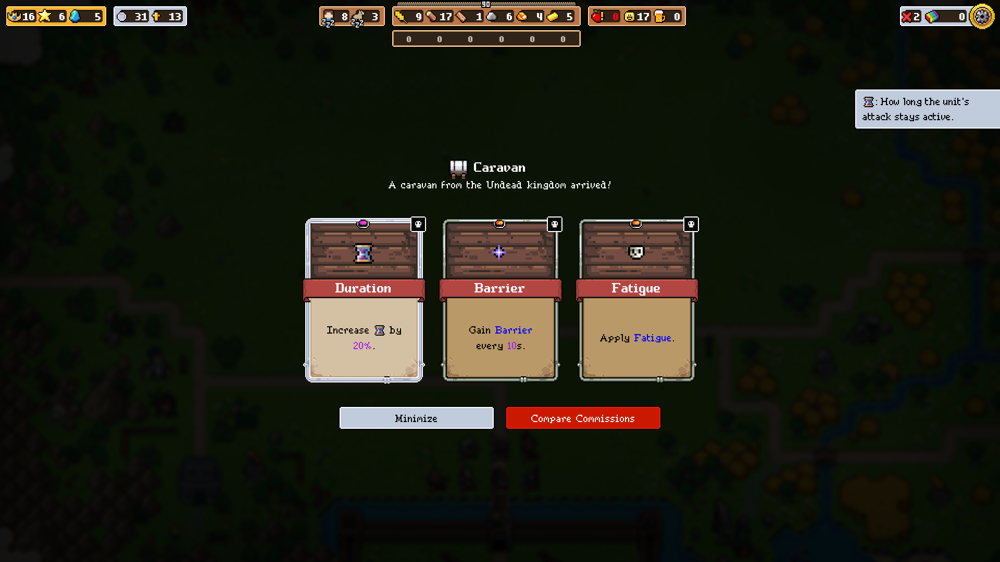
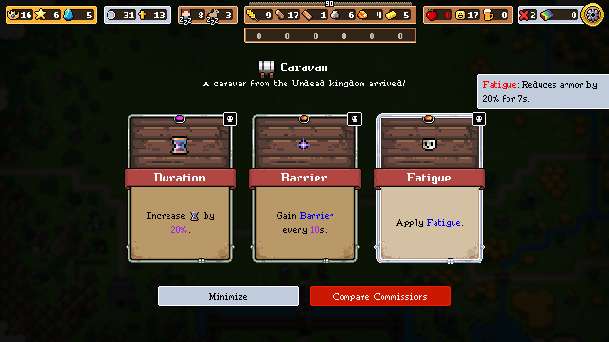

# Daily Caravan

Choose one item from a visiting kingdom’s caravan on each eligible morning. In ordinary kingdoms the first daily visit is Day 16 by default, provided the giant gate is open. An optional setting lets the wagon arrive from the configured day while the gate is still closed.

## Features

- Pick one item from the visiting kingdom’s stock. The native merchant cards show each item’s effect and keywords before you choose.
- Scheduled wagons, invitations, and the daily caravan share one visit per day. If the Hermit or another guest arrives first, finish that interaction to let the wagon through.
- Replaying the same dawn remembers a selection or decline. A checkpoint that already contains your reward keeps it.

## How to Use

1. With the default settings, open the giant gate on the world map. On the Human map, the day-29 visitor reveals the giant key. Gate progress carries over to future runs in that kingdom. Caravan progression also requires a kingdom best of at least day 14 or a current run on day 15 or later.
2. On an eligible morning, advance the wagon’s dialogue to open its cards. Look for the **Caravan** panel. The day-5 Merchant is a separate visitor who sells resources after you help them.
3. Use the D-pad to focus a card and read its keywords. Confirm with the bottom face button (A on an Xbox controller), press **Enter** on a focused card, or click the card with the mouse. The chosen item appears as a draggable drop.
4. Choose **Minimize** where available to come back to the offer. Declining spends the day’s choice.
5. To change the schedule after the first modded launch, edit `[Schedule]` in `BepInEx/config/sfk.dailycaravan.cfg` and restart the game. `FirstDay = 16` sets the earliest supplemental visit. `AllowBeforeGiantGate = false` keeps the gate requirement. Set it to `true` to allow daily visits while the gate is closed. The kingdom still needs a best day of at least 14 or a current day of at least 15. Native bookings and invitations keep their own dates.

On a copy of a Day 22 save with the gate closed, Continue opened on Day 23. With the option enabled and `FirstDay = 16`, Days 23, 24, and 25 each brought one caravan and one item. With the default gate setting, no daily caravan arrived on Day 23.

## Screenshots

**1× UI scale.** The wagon offers three items. Duration has the white focus border, and its hourglass explanation appears on the right.

**1.5× UI scale.** Focus is on Fatigue. Its tooltip shows how much armor it removes and for how long. The **Compare Commissions** button comes from [Caravan Commissions](https://thunderstore.io/c/super-fantasy-kingdom/p/GKJ/CaravanCommissions/).

Both captures show Daily Caravan 0.1.3 in Super Fantasy Kingdom 0.8.068 after Continue on a copied save. The giant gate was closed, the early-visit option was enabled, and controller focus was simulated.

## Compatibility

- Standard and Forester’s Charter use the same unlock rules. Challenges keep their authored caravan dates, weekly bookings, and invitations.
- Companion mods are optional. [Weekly Hermit](https://thunderstore.io/c/super-fantasy-kingdom/p/GKJ/WeeklyHermit/) can share a dawn with the wagon, [Visitor Calendar](https://thunderstore.io/c/super-fantasy-kingdom/p/GKJ/VisitorCalendar/) 0.1.2 or later reads both schedule settings when forecasting wagons and keeps previously missed days empty, and [Caravan Commissions](https://thunderstore.io/c/super-fantasy-kingdom/p/GKJ/CaravanCommissions/) handles its own orders and deliveries.
- The wagon draws from the visiting kingdom’s item pool. If another mod changes the stock before a reload, the available cards can change. A pool with fewer than three distinct registered items shows fewer choices.
- With [RightClickSkip](https://thunderstore.io/c/super-fantasy-kingdom/p/ownlyme/RightClickSkip/) 1.2.0, skipping the dawn caption still allows the scheduled visit. [MoreRelics](https://thunderstore.io/c/super-fantasy-kingdom/p/ownlyme/MoreRelics/) 1.1.0 adds relics to a separate pool.

## Installation

1. Open Thunderstore Mod Manager and select your **Super Fantasy Kingdom** profile.
2. Install **Daily Caravan** with its listed dependencies, [BepInExPack](https://thunderstore.io/c/super-fantasy-kingdom/p/BepInEx/BepInExPack/) and [HideManagerGameObject_Config](https://thunderstore.io/c/super-fantasy-kingdom/p/BepInEx/HideManagerGameObject_Config/).
3. Choose **Start modded** and continue an eligible kingdom.

For save and reload details, build commands, and packaging instructions, see the [developer reference](docs/save-and-build.md). See the [contribution guide](CONTRIBUTING.md) to report an issue or propose a change.
