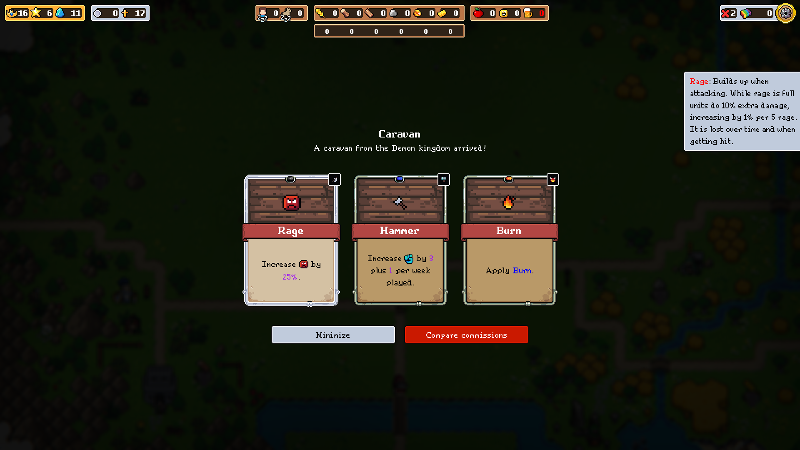
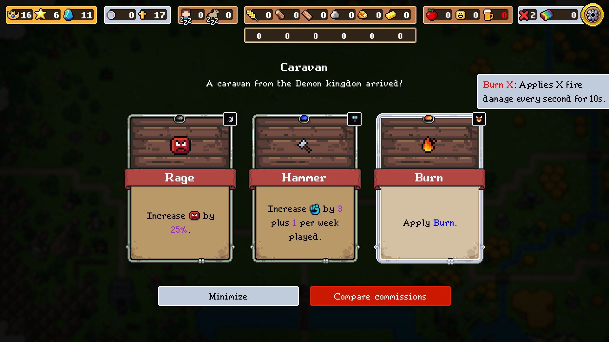

# Daily Caravan

Choose one item from a visiting kingdom’s caravan on each eligible morning. By default, the daily wagon can arrive from day 16 onward, once you have opened the giant gate and unlocked caravans.

## Features

- Pick one item from the visiting kingdom’s stock. The native merchant cards show each item’s effect and keywords before you choose.
- Scheduled wagons, invitations, and the daily caravan share one visit per day. If the Hermit or another guest arrives first, finish that interaction to let the wagon through.
- Replaying the same dawn remembers a selection or decline. A checkpoint that already contains your reward keeps it.

## How to Use

1. Open the giant gate on the world map. On the Human map, the day-29 visitor reveals the giant key. Gate progress carries over to future runs in that kingdom. Caravan progression also requires a kingdom best of at least day 14 or a current run on day 15 or later.
2. On an eligible morning, advance the wagon’s dialogue to open its cards. Look for the **Caravan** panel. The day-5 Merchant is a separate visitor who sells resources after you help them.
3. Use the D-pad to focus a card and read its keywords. Confirm with the bottom face button (A on an Xbox controller), press **Enter** on a focused card, or click the card with the mouse. The chosen item appears as a draggable drop.
4. Choose **Minimize** where available to come back to the offer. Declining spends the day’s choice.
5. To change the first daily visit, set `FirstDay` under `[Schedule]` in `BepInEx/config/sfk.dailycaravan.cfg` after the first modded launch, then restart the game. An earlier setting still requires both unlocks. Native bookings and invitations can arrive before your configured day.

## Screenshots

**1× UI scale.** The Demon kingdom offers three items. Focusing Rage opens its keyword description on the right.

**1.5× UI scale.** The same offer has Burn focused. Its keyword panel sits above the card. Both captures are from Super Fantasy Kingdom 0.8.068 with simulated D-pad input. The “Compare commissions” button comes from [Caravan Commissions](https://thunderstore.io/c/super-fantasy-kingdom/p/GKJ/CaravanCommissions/).

## Compatibility

- Standard and Forester’s Charter use the same unlock rules. Challenges keep their authored caravan dates, weekly bookings, and invitations.
- The companion mods are optional. [Weekly Hermit](https://thunderstore.io/c/super-fantasy-kingdom/p/GKJ/WeeklyHermit/) can share a dawn with the wagon, [Visitor Calendar](https://thunderstore.io/c/super-fantasy-kingdom/p/GKJ/VisitorCalendar/) can display visitor portraits, and [Caravan Commissions](https://thunderstore.io/c/super-fantasy-kingdom/p/GKJ/CaravanCommissions/) handles its own orders and deliveries.
- The wagon draws from the visiting kingdom’s item pool. If another mod changes the stock before a reload, the available cards can change. A pool with fewer than three distinct registered items shows fewer choices.
- With [RightClickSkip](https://thunderstore.io/c/super-fantasy-kingdom/p/ownlyme/RightClickSkip/) 1.2.0, skipping the dawn caption still allows the scheduled visit. [MoreRelics](https://thunderstore.io/c/super-fantasy-kingdom/p/ownlyme/MoreRelics/) 1.1.0 adds relics to a separate pool.

## Installation

1. Open Thunderstore Mod Manager and select your **Super Fantasy Kingdom** profile.
2. Install **Daily Caravan** with its listed dependencies, [BepInExPack](https://thunderstore.io/c/super-fantasy-kingdom/p/BepInEx/BepInExPack/) and [HideManagerGameObject_Config](https://thunderstore.io/c/super-fantasy-kingdom/p/BepInEx/HideManagerGameObject_Config/).
3. Choose **Start modded** and continue an eligible kingdom.
